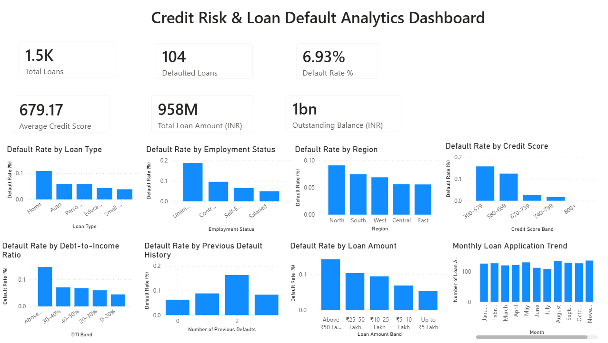

# Credit Risk & Loan Default Analytics

## Project Overview

This project analyzes loan portfolio performance and borrower credit risk using **Excel, SQL, Python, and Power BI**. The objective is to identify default patterns across borrower segments, evaluate loan portfolio characteristics, and present insights through a dashboard.

## Business Objectives

- Evaluate loan portfolio performance and default rates.
- Analyze defaults across loan types, employment statuses, and regions.
- Explore relationships between credit scores, debt-to-income ratios, and previous defaults.
- Segment borrowers into meaningful credit risk categories.
- Build a Power BI dashboard for portfolio monitoring and reporting.

## Tools & Technologies

- **Microsoft Excel** — Data preparation
- **MySQL** — SQL queries and portfolio analysis
- **Python** — Data cleaning, exploratory data analysis, and visualizations
- **Power BI** — Dashboard development and KPI reporting

## Dataset

The project uses a **synthetic dataset of 1,500 loan records** containing borrower, credit, loan, and repayment-related attributes.

Key fields include:

- Borrower ID and application date
- Age, employment status, and annual income
- Credit score and credit utilization
- Loan type, amount, tenure, and interest rate
- Debt-to-income ratio and previous default count
- Missed payments and outstanding balance
- Loan status and default flag

**Note:** The dataset is synthetic and contains no real borrower information.

## Key Performance Indicators

| KPI | Result |
|---|---:|
| Total Loans | 1,500 |
| Defaulted Loans | 104 |
| Default Rate | 6.93% |
| Average Credit Score | 679.17 |

## Power BI Dashboard

The dashboard includes KPI cards and visualizations covering default rates by loan type, employment status, region, credit score band, debt-to-income band, previous default history, and loan amount band. It also presents monthly loan application trends.

## Analysis Performed

### SQL Analysis
- Overall loan portfolio summary
- Default rates by loan type, region, and employment status
- Credit score and debt-to-income segmentation
- Previous default history analysis
- Loan amount and interest rate analysis
- Monthly application trends
- High-risk borrower review

### Python Analysis
- Data cleaning and validation
- Exploratory data analysis
- KPI calculations
- Default-rate comparisons across borrower groups
- Data visualizations and analytical result exports

### Power BI
- Portfolio KPI cards
- Default rate comparisons across borrower segments
- Credit score, DTI, and loan amount band analysis
- Monthly loan application trend

## Key Findings

- The dataset contains 104 defaulted loans out of 1,500 records, giving an overall default rate of approximately 6.93%.
- Default patterns vary across loan types and employment categories.
- Credit score bands and debt-to-income segments help compare default rates between borrower groups.
- Previous default history provides an additional dimension for examining borrower risk.

These findings describe patterns in synthetic data. They do not establish causation or predict the behavior of real borrowers.

## Project Files

| File | Description |
|---|---|
| `Credit_Risk_Loan_Default_Analytics.pbix` | Power BI dashboard |
| `Credit_Risk_Loan_Default_Analytics.sql` | SQL analysis queries |
| `Credit_Risk_Loan_Default_Analytics_Cleaned.xlsx` | Cleaned dataset |
| `Credit_Risk_Analytics_Results.xlsx` | Python analysis results |
| `Credit_Risk_Loan_Default_Analytics.png` | Dashboard screenshot |

## Skills Demonstrated

SQL | Python | Excel | MySQL | Power BI | Data Cleaning | Exploratory Data Analysis | Financial Analytics | Credit Risk Analysis | KPI Reporting | Data Visualization

## Author

**Tanvi Kamat**

*Credit Risk Analytics | Financial Analytics | Data Analysis*

